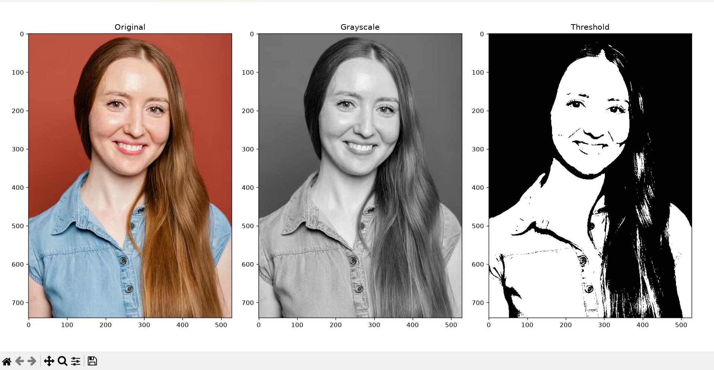

# NumPy Image Processing

A small image processing project built using **Python, NumPy, and Matplotlib**.

## Features

- Loads an RGB image
- Extracts Red, Green, and Blue channels
- Converts RGB image to grayscale
- Applies binary thresholding
- Visualizes the original, grayscale, and thresholded images

## Technologies Used

- Python
- NumPy
- Matplotlib

## Grayscale Conversion

The RGB image is converted into grayscale using:

`Grayscale = 0.2989R + 0.5870G + 0.1140B`

## Thresholding

A threshold value of `128` is used to convert the grayscale image into a binary image.

Pixels greater than the threshold are assigned `255` (white), while the remaining pixels are assigned `0` (black).

## How to Run

Install the required libraries:

```bash
pip install -r requirements.txt
```

Run the project:

```bash
python project.py
```

## Output

The program displays:

1. Original image
2. Grayscale image
3. Thresholded image

## Result

